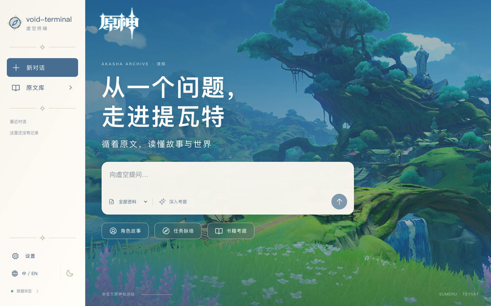

# void-terminal · 虚空终端

面向原神文本考据的开源问答与资料库。Next.js 页面通过内部 Python 知识服务检索有来源的文本，由官方 DeepSeek Harness（DSH）运行检索工具循环、会话和上下文压缩，再向配置的 OpenAI 兼容接口发起带引用的流式回答。支持中文与英文、来源回看和快照；自托管版使用自己的模型 Key，官方托管版使用邮箱登录与积分。



[原文库截图](docs/screenshots/library.png) · [原文阅读截图](docs/screenshots/reading.png) · [手机首页](docs/screenshots/mobile-home.png) · [手机来源面板](docs/screenshots/mobile-source.png)。这些是实际页面截图；阅读页连接本地真实语料，不是设计概念图。

**仓库不附带完整游戏数据库。** 空库会明确显示未就绪；测试夹具不代表真实语料覆盖。首次使用前需要导入真实来源。已发现、已导入、缺少文本与未解析的数量以 `/api/status` 的 `coverage` 为准；源仓库提交和游戏版本是两回事，未知游戏版本保持为空。知识检索失败时不会补造游戏资料。

首页侧栏的「提瓦特舆图 / Teyvat Atlas」（`/map`）提供国度、区域和资源查询，无需模型 Key。地图查询也可在对话中返回带围栏、标点、数量和来源的交互式 Canvas 卡片，并保存地图版本。地图数据需单独准备；查询接口、卡片协议和本地使用见 [地图接入](docs/map-chat.md)。

图鉴、装备和资料浏览的正文跟随界面语言。设置中的「原文语料语言 / Source language」只控制对话考据检索，引用仍保留所选原文。

## 两种部署模式

同一个开源仓库、同一份 Web 镜像，通过运行时环境变量 `DEPLOYMENT_MODE` 选择模式，不需要分别构建：

| 模式 | 问答入口 | 运行依赖 |
| --- | --- | --- |
| `self-hosted`（默认） | 在设置中填写自己的模型 Key（BYOK） | 知识服务与语料；无需 Supabase、SMTP、账户或积分配置 |
| `hosted` | 邮箱验证码登录后使用账户积分 | Supabase Auth、生产 SMTP、独立积分账本及管理员模型 Key |

自托管版不显示登录、积分或账户入口，也不会使用服务器共享 Key。官方托管版不提供 BYOK、接口/模型覆盖或模式切换；认证、模型或预算配置缺失时拒绝生成，不会降级为 BYOK。服务端也会拒绝不属于当前部署模式的请求。

仅未设置 `DEPLOYMENT_MODE` 时默认 `self-hosted`；显式空值、拼写错误或其他值均按配置错误拒绝服务。两个 Compose 文件都在容器运行时传入该变量；改值后需重新创建 Web 容器。**已有官方托管实例升级前必须显式设置 `DEPLOYMENT_MODE=hosted`，并保留原 `accounts` 卷。** 托管配置见 [账户与积分运维指南](docs/operations/account-trial.md)。内部订单、入账流水和恢复工具已提供；Stripe 为后续支付渠道，目前未开放真实充值或订阅。升级账本前先阅读 [额度账本迁移与恢复](docs/operations/credit-ledger.md)。

## 本地开发

要求 Node.js 24、Python 3.11、uv；Docker 部署另外需要 Docker Engine 与 Compose v2。根目录 npm workspaces 和单一 `package-lock.json` 负责前端依赖；Python 使用 `services/knowledge/uv.lock`。

npm 锁文件记录了 npm mirror 的下载地址；Python 锁文件使用官方 PyPI / files.pythonhosted.org，并保留具体版本与文件哈希。安装机器需要能访问锁定地址；只修改命令行 registry 不会重写已有下载 URL。

```sh
cp .env.example .env
npm ci
cd services/knowledge
uv sync --frozen --group dev
cd ../..
bash scripts/dev.sh
```

打开 <http://127.0.0.1:3000>，在设置中填写自己的模型 Key；默认 `DEPLOYMENT_MODE=self-hosted`，无需设置服务器模型 Key 或账户服务。开发脚本只监听 localhost，并启动 8000 端口的知识服务。默认 SQLite 文件为 `data/catalog.sqlite`。低流量单机部署可使用 `compose.sqlite.yaml` 复用现有快照；需要向量索引或更高语料查询并发时使用默认的 PostgreSQL + pgvector 配置。托管版积分账本独立使用 SQLite，两种语料后端均可搭配；积分功能不要求 PostgreSQL。SQLite 语料验证不能代替 PostgreSQL 并发验证。

`.env` 由开发脚本读取；单独运行 Python CLI 时，需要自己导出需要的环境变量。不要提交 `.env`、浏览器密钥、数据库、下载语料或模型权重。

## 生产部署

单台服务器的快捷 HTTPS 方案、SQLite 完整快照迁移与 Key 隐私说明见 [快速部署指南](docs/deploy-fast.md)。`compose.sqlite.yaml` 独立运行 Web、知识服务和 Caddy，默认使用自托管模式并关闭向量模型；下面的命令则使用 PostgreSQL。

```sh
cp .env.example .env
# 编辑 .env，至少填入 POSTGRES_PASSWORD 和 KNOWLEDGE_API_TOKEN。
# 保留 DEPLOYMENT_MODE=self-hosted；在浏览器设置中填写自己的模型 Key。
# 两者可分别用 openssl rand -hex 32 生成；数据库密码使用 URL 安全字符。
docker compose build
docker compose up -d --wait db knowledge web
curl --fail http://127.0.0.1:3000/api/status
```

Web 采用 Next.js standalone，Node 24；知识服务采用 Python 3.11/uv；数据库使用带 vector 扩展的 PostgreSQL 17 镜像。依赖由锁文件固定；基础镜像标签可更新，正式环境应按组织流程另行固定经审查的镜像 digest。

只有 Web 绑定宿主 `127.0.0.1:3000`；数据库和知识服务不发布宿主端口。知识接口在生产要求 `X-Knowledge-Token`，Web 从运行时环境注入该请求头。镜像构建不接收模型密钥或内部令牌。`database`、`sources`、`models` 三个命名卷分别保存语料数据库、来源文件与模型缓存；`accounts` 卷独立保存托管版积分账本。不要执行 `docker compose down -v`，它会删除这些数据。

公网部署需要域名、有效 TLS 证书和由管理员管理的反向代理。参考 [deploy/nginx.conf](deploy/nginx.conf)，替换域名和证书路径后先运行 `nginx -t`。它关闭 SSE 缓冲和缓存、延长流式读取超时、覆盖客户端传入的代理地址并限制请求频率。仅当所有入口都经过这个受控代理时设置 `TRUST_PROXY=true`。知识服务和数据库继续保持内网隔离。

托管版还要求 `PUBLIC_APP_ORIGIN=https://你的域名`，与浏览器访问的 HTTPS origin 精确一致，不含路径、账号密码、查询参数和 fragment；它独立于代理头，用于校验登录和积分问答请求来源。不能把容器内部 `http://0.0.0.0:3000` 或 `http://web:3000` 填作公网地址。本地 `npm dev` 演练托管版也必须显式填写浏览器 origin，可使用 `http://127.0.0.1:3000`；Docker Web 使用 production 模式，即使本地演练也需要受信任的 HTTPS 入口。自托管 BYOK 不依赖这些账户配置。

## 首次导入与快照

导入是独立作业，不随 Web 容器启动自动执行。先查看真实 CLI 的帮助，然后使用下方导入流程；切勿把下载完成等同于导入、索引构建和激活成功。

```sh
docker compose --profile ingest run --rm ingest --help
```

默认来源固定为 `DimbreathBot/AnimeGameData@792978e5503ecfba73dcb3562ed44a0d35a2abe2` 和 `theBowja/genshin-db@49a6544a6c6ae36089cb42fa591fc46f01de8bcf`，不会静默追踪 main。先审查上游许可和所需磁盘，再运行：

```sh
docker compose --profile ingest run --rm ingest fetch --source main --destination /data/sources/AnimeGameData
docker compose --profile ingest run --rm ingest fetch --source supplement --destination /data/sources/genshin-db
docker compose --profile ingest run --rm ingest normalize --input /data/sources/AnimeGameData --supplementary /data/sources/genshin-db --output /data/sources/normalized
docker compose --profile ingest run --rm ingest import --normalized /data/sources/normalized --no-activate
docker compose --profile ingest run --rm ingest snapshots
```

下载支持已校验缓存复用和分段重试；主源使用同一固定提交的 GitLab 路径归档获取目标目录，补充源默认使用随代码固定的文件清单获取 5 类主要实体。补充源仅覆盖其 30 类目录中的 5 类，标记为部分获取，不能宣称整个整理库已完整覆盖。网络与上游变更仍可能阻止完整获取；显式使用 `fetch --tree-file` 时，应提供真实完整 recursive tree JSON，不能用裁剪树绕过完整性检查。下载失败时保留原有活动快照。CLI 报告的 `acquisitionComplete`、`report.json` 中主源/补充源获取状态与 coverage 应一起检查；下载完整也不等于规范化和数据库导入已经完成。归一化输出放在 source 持久卷，避免独立作业退出后文件丢失。

先审查 `snapshots`、输出目录里的 `coverage.json`/`report.json`，并使用 `snapshotId` 参数抽样查阅暂存快照，再显式激活：

```sh
# 用 snapshots 输出的真实 ID 替换 SNAPSHOT_ID。
docker compose --profile ingest run --rm ingest activate SNAPSHOT_ID
# 回滚只切换到已导入、ready 的旧快照。
docker compose --profile ingest run --rm ingest rollback PREVIOUS_SNAPSHOT_ID
```

更新来源适配器/固定提交后，可用 `update --input /data/sources/AnimeGameData --supplementary /data/sources/genshin-db --output /data/sources/normalized --no-activate` 完成归一化与暂存导入。不可复用已存在的 snapshot ID；模型变化但正文不变时使用 `--snapshot-id NEW_ID`。本地运行相同 CLI 可在 `services/knowledge` 下将 `docker compose … ingest` 换成 `uv run --frozen python -m knowledge.ingest`，并使用自己的本地目录。

导入后重新检查 `/api/status`：确认 `activeSnapshot.sourceCommit`、文档与 chunk 数量、语言和每类 coverage。任务、对话、书籍、装备等类型的覆盖必须分别审查；“支持某种类型”不等于该类型全量导入。保留 snapshot ID，以便问答和资料浏览指向同一版本。

## 群星图鉴

`/characters` 提供角色头像、原始立绘、等级与突破属性、天赋倍率、命之座、故事、语音及培养材料，与万象集录共用来源阅读和快照。中英文本与汉英日韩配音分别选择；点击播放才获取原声音频。来源缺失会明确标注，角色记录数量不代表已实装数量。

新版本 `normalize` 会同时生成 `characters.jsonl` 和 `character-coverage.json`。补充源获取范围增加固定提交的 `src/data/image/characters.json`；旧缓存需要重新执行获取校验，不能直接改 marker 宣称已包含新文件。媒体验证在导入前执行，使用新的归一化输出目录，勿覆盖已经发布的快照文件：

```sh
# 先按上文 fetch / normalize 流程准备新的 normalized 目录。
docker compose --profile ingest run --rm ingest verify-character-media --normalized /data/sources/normalized --supplementary /data/sources/genshin-db --cache /data/sources/character-media-cache
docker compose --profile ingest run --rm ingest import --normalized /data/sources/normalized --no-activate
docker compose --profile ingest run --rm ingest snapshots
```

验证器检查原图格式与尺寸，并从固定 revision 的语音 ZIP 读取有界目录，按原始资源路径哈希匹配，不下载整个语音库。播放时仅获取选中片段，检查大小、CRC 和 PCM WAV。媒体映射参与语料摘要，因此验证后会产生新的 snapshot ID；审查 `character-coverage.json`、缓存目录的 `report.json` 和真实播放后，再按上文流程显式激活。音频索引覆盖不等于每条录音均已试听。未构建角色表的历史快照仍可阅读原文，图鉴显示未构建状态。

数据契约见 [角色契约](docs/characters-contract.md)，本地真实数据、浏览器验收与来源缺口见 [群星图鉴实施记录](docs/agent/feature/2026-11-05-character-archive.md)。本地验收库仅包含角色、培养材料及关联文献，不可作为生产全量语料替代品。

## Embedding 与检索成本

默认 `EMBEDDING_ENABLED=false`，只运行词法检索。模型默认 `intfloat/multilingual-e5-small`，384 维；语义检索需要真实本地权重、固定 40 字符 revision、兼容 manifest 和以同一模型建立的索引，不会使用随机向量冒充。模型权重不会在知识服务启动时自动下载。

生产模型卷挂载到 `/app/models`；manifest 位于 `/app/models/embedding-manifest.json`，本地位于 `models/embedding-manifest.json`。manifest 需要 `model`、`revision`、`dimensions:384` 和 `preprocessing:"e5-prefix-l2-v1"`。权重必须在模型加载器使用的本地缓存目录中。启用前按该模型固定 revision 下载并校验权重，再导入/重建匹配索引。具体状态以 `/api/status.retrieval` 为准；缺失缓存或不兼容 manifest 不表示语义检索就绪。

在审查模型卡并选定真实 revision 后，可在独立作业中准备权重和 manifest（需要外网）：

```sh
# 先在 .env 中设置 KNOWLEDGE_SEMANTIC_BUILD=true；运行时 EMBEDDING_ENABLED 暂时保持 false。
docker compose --profile ingest build knowledge ingest
E5_REVISION=REPLACE_WITH_AUDITED_40_CHARACTER_COMMIT
docker compose --profile ingest run --rm --no-deps ingest prepare-embeddings --revision "$E5_REVISION" --manifest-path /app/models/embedding-manifest.json
```

随后设置 `EMBEDDING_ENABLED=true`，使用新的 snapshot ID 导入索引，再重建/启动知识服务并核查 semantic 状态。已有词法快照不会仅因修改开关就自动补齐向量。

默认 `KNOWLEDGE_SEMANTIC_BUILD=false`，Python 镜像只安装词法检索所需依赖，不包含 torch/sentence-transformers。设为 true 并重建后才安装 semantic extra；模型文件仍另存持久卷。构建开关和运行时 `EMBEDDING_ENABLED` 是两个独立设置。首次下载需要网络、磁盘和模型许可证审查；全量 embedding 需要 CPU/GPU 时间和索引存储。默认使用本地 embedding，不产生远程 embedding API 费用；回答仍消耗你配置的模型服务额度。

## 自托管 Key 设置与托管积分

自托管版在页面 Key 设置中输入兼容模型服务密钥并测试连接。密钥只保存在当前页面内存，刷新后需要重新输入，不写入浏览器持久存储、数据库或对话导出。请求路径是 **浏览器 → 你部署的实例 → 选定的模型服务**；BYOK 通过 `X-Model-Api-Key` 请求头发送，由实例后端代理模型调用。不要把密钥放到 URL、聊天正文、截图或问题反馈里。请只在自己信任的 HTTPS 实例输入密钥。设置中可填写自己的 **Base URL** 和 **Model name**，留空的字段使用站点默认值。更换地址会清空当前 Key；模型需支持 OpenAI 兼容的 Chat Completions、流式输出和工具调用。模型列表连接测试不产生生成请求，也不代表工具调用能力已验证。实例运营者技术上能够接触转发的 Key；HTTPS 保护传输，不代表运营者不可见。所选供应商还会收到问题、历史对话和相关原文。

托管版必须设置 `DEPLOYMENT_MODE=hosted`，并按 [账户与积分运维指南](docs/operations/account-trial.md) 配齐邮箱登录、账本及模型配置。`SHARED_MODE_ENABLED=true` 是托管模型服务的内部开关，不是向访客开放的切换项；自托管版忽略该开关和服务器模型 Key。托管版要求邮箱登录和设备验证。符合条件的账户每日可用 3 点（北京时间零点重置，未用不累计），新账户默认另获 20 点储备；普通考据 1 点，深入考据 3 点，先用每日点数。托管 Compose 要求设置正数 `SHARED_MONTHLY_TOKEN_BUDGET`，并设置有限正数 `SHARED_DAILY_TOKEN_BUDGET`。全站日/月 token 预算按 UTC 日历预留与结算，独立于账户点数；异常和取消可能保留最坏额度，不能把本地预算当成供应商账单或硬性消费上限。对外开放前设置供应商侧限额。

托管站可在运行环境配置 [公开联系邮箱及赞助渠道](docs/operations/account-trial.md#optional-sponsorship-and-contact)。只有实际配置的有效入口才显示。赞助可通过已核实的外部页面、二维码或站长提供的 BNB Smart Chain 主网收款地址进行，不兑换点数；站内没有支付、钱包签名或自动发点。自托管版没有这些入口，也不加载设备验证。

自托管 BYOK 可指定公网 HTTPS 模型接口及模型 ID；服务器验证所有 DNS 结果，并将实际 TLS 连接固定到已验证的地址，拒绝内网、环回、云元数据和重定向。接口可包含供应商需要的 `/v1` 等前缀，不可携带 Key、账号密码、查询参数或 fragment。Base URL 和模型名可保存在本机，Key 不进入偏好或历史。托管版的服务器 Key 始终只发送给管理员配置的地址；旧浏览器偏好不能切换为 BYOK。

管理员设置站点默认接口时，仍使用 `DEEPSEEK_BASE_URL`、`DEEPSEEK_MODEL` 与精确 origin 允许清单。除默认 `https://api.deepseek.com` 外，需同时设置 `DEEPSEEK_BASE_URL` 与 `DEEPSEEK_ALLOWED_BASE_URLS`。后者为逗号分隔的精确 HTTPS origin（不含路径或末尾斜杠）；例如 `DEEPSEEK_BASE_URL=https://models.example.com/v1` 对应 `DEEPSEEK_ALLOWED_BASE_URLS=https://models.example.com`。接口路径仅支持根路径或 `/v1`，不支持 URL 中的账号密码、查询参数和 fragment。重新创建 Web 容器后生效。

## Agent runtime 与升级

运行时使用官方 [DeepSeek Harness](https://github.com/deepseek-ai/deepseek-harness) 的内核组件，全部固定为 `0.2.1-rc.5`。`apps/web/src/lib/server/dsh-runtime.ts` 是唯一框架适配层；`research.ts` 负责原神证据、快照和引用规则，`agent.ts` 负责回答策略和调用预算。每次请求创建独立内存会话，恢复浏览器历史，结束后关闭 Context 和私有模型传输桥。没有挂载 Shell、文件访问、持久凭证、磁盘会话日志或遥测插件。

DSH 不会收到访客真实 Key；私有桥通过现有公网 HTTPS/DNS 固定传输转发模型请求。Key 仍会经过站点服务器，运营者的信任边界不变。工具研究、压缩和最终回答合计最多五次模型请求，禁用隐式重试。浏览器历史继续保存在本机；服务重启后不能恢复正在执行的服务端任务。

DSH 的预览版本接口可能变化。升级时统一修改根 `package.json` 的 DSH 版本并更新锁文件，不能混用 master 的 alpha 接口与 npm 候选版。根包同时覆盖 Zod 至修复版本，避免 workspace 链接导致覆盖失效。执行 `npm ci`、`npm audit --omit=dev`、`npm test`、`npm run build` 与 `npm run test:e2e`，再按 [运行时维护记录](docs/agent/optimize/2026-11-02-dsh-runtime.md) 验证完整语料和独立生产产物。不要用 `npm audit fix --force` 单独升级 DSH 组件。

## 更新、激活与回滚

先做备份并记录当前代码提交、活动 snapshot ID 和模型 manifest。通过自己的发布流程取回并检出已审查的新提交，执行 `bash scripts/update.sh`；脚本要求干净工作区、构建当前代码并等待 Web/知识服务健康。脚本不拉取未知更新，不自动更新语料，也不替换数据库主版本。

已有托管部署需在启动新镜像前将 `DEPLOYMENT_MODE=hosted` 加入原 `.env`；不要用示例文件覆盖现有凭据。保留 Compose 项目名、原 `accounts` 卷和 ledger 路径。**本版知识服务会把旧账户账本升级为 schema v3，旧二进制不能直接读取升级后的库；先停写、备份并按 [迁移与恢复流程](docs/operations/credit-ledger.md) 演练。** 发布后核对 `/api/status.deployment.mode` 与浏览器入口：托管版应显示账户/积分且无 Key 设置，自托管版则应只有 BYOK。模式切换不会迁移或合并本机访客与账户聊天历史。

语料更新应导入新的快照，检查 coverage 和抽样来源后再激活；旧快照保留用于回滚。代码回滚时检出之前记录的提交，重建并启动对应镜像。若新版本更改了数据结构，先在隔离环境验证旧代码兼容性；不兼容时需要恢复对应数据库备份，不能只回滚容器。模型或预处理改变时必须建立匹配的新索引。

## 备份与恢复

暂停导入、快照激活和共享写入，在维护窗口备份数据库与来源，确保跨资源一致性：

```sh
# 先确认所有独立导入作业已经结束，暂停对外写入。
docker compose stop web knowledge
bash scripts/backup.sh /absolute/path/to/new-backup-directory
docker compose up -d --wait knowledge web
```

脚本生成逻辑 SQL、来源归档、代码提交和 `runtime.env`。备份包含密钥与数据，应加密后离机保存；模型缓存可按固定 revision 重新下载。不要只复制运行中的数据库卷。SQLite 开发库可在停止开发服务后连同 `data/`、来源、模型 manifest 和 `.env` 一起备份。

上述 `backup.sh` / `restore.sh` 仅处理 PostgreSQL 语料与来源，**不包含 `accounts` 卷**。托管版必须另外使用 [账户账本专用工具](docs/operations/credit-ledger.md) 备份、验证和恢复 `/accounts/accounts.sqlite`；语料快照、PostgreSQL 备份与账户账本不能互相替代。

定期在全新 Compose 项目/空数据库做恢复演练，不覆盖在线实例。先准备受保护的 `.env` 并按记录检出兼容代码，然后执行：

```sh
# 新项目名确保使用独立命名卷；在当前 shell 后续命令保持一致。
export COMPOSE_PROJECT_NAME=void-terminal-restore
bash scripts/restore.sh /absolute/path/to/backup --confirm-empty-target
# 确保没有端口冲突，再启动恢复实例。
WEB_PORT=3001 docker compose up -d --wait knowledge web
curl --fail http://127.0.0.1:3001/api/status
```

恢复脚本拒绝已有 public 表的数据库，不会自动替换 `.env`。启动后核对活动快照、coverage、样本文档、引用回看和测试提问；确认恢复有效后再决定生产切换。

## 验证与边界

本次实现的真实数据规模、检索评测、浏览器结果和未验证项见 [2026-10-28 验证记录](docs/validation/2026-10-28.md)。该记录描述本地工作区，克隆仓库仍需自行获取和导入语料。

```sh
npm run typecheck
npm test
npm run build
python -m unittest discover -s eval -p 'test_*.py' -v
cd services/knowledge && uv run --frozen pytest
# 回到仓库根目录；先安装 Chromium：
cd ../..
(cd apps/web && npx playwright install chromium)
npm run test:e2e
```

GitHub Actions 配置了类型、单元、Python、构建和浏览器基础检查。CI 使用独立的 `pgvector/pgvector:pg17` 临时服务，通过 `TEST_POSTGRES_URL` 启用真实 PostgreSQL 快照导入、检索、前缀索引与来源读取测试；公开的 CI 密码只用于该临时数据库。本地未提供该变量时 PostgreSQL 测试会明确跳过，不以 SQLite 代替。具体提交是否通过以 GitHub Actions 的实际运行结果为准。

PostgreSQL 原文库的英文前缀检索使用 `LIKE` 与 `text_pattern_ops` 索引，兼容 `en_US.utf8` 等排序规则。升级时启动事务会为已有 `chunk_tokens` 创建 `tokens_prefix_lookup` 索引；大语料库需预留索引磁盘和首次建索引的维护时间。SQLite 不受此变更影响。

测试不使用真实模型密钥，不等于真实数据全量导入、远程模型计费验证或生产验收。完整 Compose 部署、重启、导入与恢复仍需在有 Docker 的机器上演练；开发工作机没有 Docker 时不能声称容器部署已通过。

原神风景为官方原图素材，权利归原权利人；详见 [THIRD_PARTY_NOTICES.md](THIRD_PARTY_NOTICES.md) 与[素材来源](docs/design/genshin-v2/assets/scenery-sources.md)。项目原创代码采用 MIT；游戏文本、第三方数据和模型不因此获得 MIT 授权。
