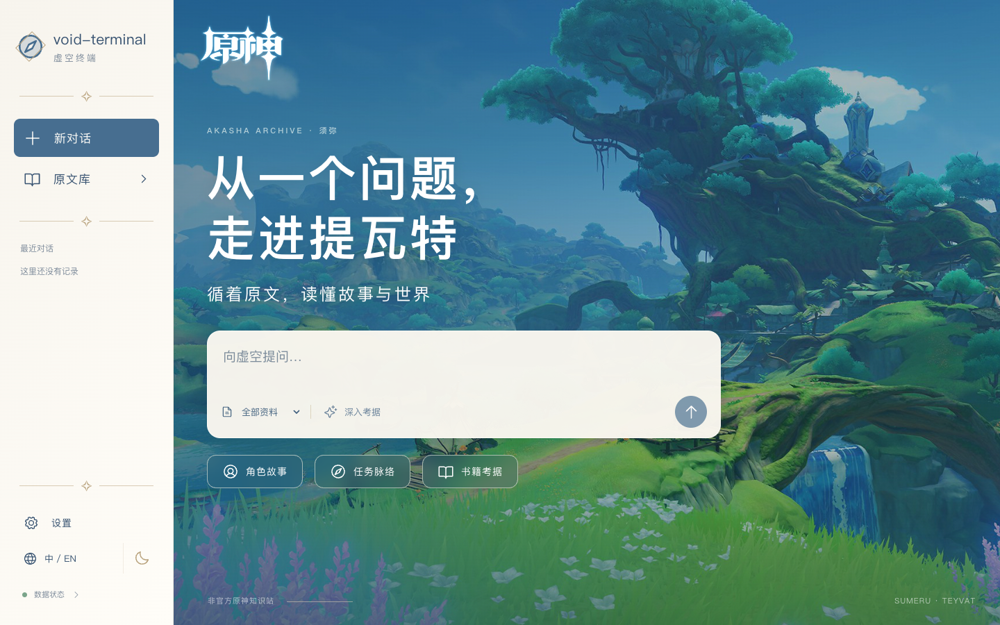

# void-terminal · 虚空终端

面向原神文本考据的自托管问答与资料库。Next.js 页面通过内部 Python 知识服务检索有来源的文本，再向配置的 DeepSeek 兼容接口发起带引用的流式回答。支持中文与英文、来源回看、快照和本地密钥模式。



[原文阅读截图](docs/screenshots/reading.png) · [手机首页](docs/screenshots/mobile-home.png) · [手机来源面板](docs/screenshots/mobile-source.png)。这些是实际页面截图；阅读页连接本地真实语料，不是设计概念图。

**仓库不附带完整游戏数据库。** 空库会明确显示未就绪；测试夹具不代表真实语料覆盖。首次使用前需要导入真实来源。已发现、已导入、缺少文本与未解析的数量以 `/api/status` 的 `coverage` 为准；源仓库提交和游戏版本是两回事，未知游戏版本保持为空。知识检索失败时不会补造游戏资料。

## 本地开发

要求 Node.js 24、Python 3.11、uv；Docker 部署另外需要 Docker Engine 与 Compose v2。根目录 npm workspaces 和单一 `package-lock.json` 负责前端依赖；Python 使用 `services/knowledge/uv.lock`。

当前锁文件在 npm mirror 与清华 PyPI 镜像上生成，记录了具体下载地址和完整性哈希。安装机器需要能访问这些地址；切换源时应按组织流程重新生成并审查锁文件，不能仅修改命令行 registry 就假定锁定下载地址已改变。

```sh
cp .env.example .env
npm ci
cd services/knowledge
uv sync --frozen --group dev
cd ../..
bash scripts/dev.sh
```

打开 <http://127.0.0.1:3000>。开发脚本只监听 localhost，并启动 8000 端口的知识服务。默认 SQLite 文件为 `data/catalog.sqlite`，适合单机开发和小语料验证；生产使用 PostgreSQL + pgvector，不应把 SQLite 的结果当作生产并发、向量索引或配额事务验证。

`.env` 由开发脚本读取；单独运行 Python CLI 时，需要自己导出需要的环境变量。不要提交 `.env`、浏览器密钥、数据库、下载语料或模型权重。

## 生产部署

```sh
cp .env.example .env
# 编辑 .env，至少填入 POSTGRES_PASSWORD 和 KNOWLEDGE_API_TOKEN。
# 两者可分别用 openssl rand -hex 32 生成；数据库密码使用 URL 安全字符。
docker compose build
docker compose up -d --wait db knowledge web
curl --fail http://127.0.0.1:3000/api/status
```

Web 采用 Next.js standalone，Node 24；知识服务采用 Python 3.11/uv；数据库使用带 vector 扩展的 PostgreSQL 17 镜像。依赖由锁文件固定；基础镜像标签可更新，正式环境应按组织流程另行固定经审查的镜像 digest。

只有 Web 绑定宿主 `127.0.0.1:3000`；数据库和知识服务不发布宿主端口。知识接口在生产要求 `X-Knowledge-Token`，Web 从运行时环境注入该请求头。镜像构建不接收模型密钥或内部令牌。`database`、`sources`、`models` 三个命名卷分别保存数据库、来源文件与模型缓存；不要执行 `docker compose down -v`，它会删除这些数据。

公网部署需要域名、有效 TLS 证书和由管理员管理的反向代理。参考 [deploy/nginx.conf](deploy/nginx.conf)，替换域名和证书路径后先运行 `nginx -t`。它关闭 SSE 缓冲和缓存、延长流式读取超时、覆盖客户端传入的代理地址并限制请求频率。仅当所有入口都经过这个受控代理时设置 `TRUST_PROXY=true`。知识服务和数据库继续保持内网隔离。

生产共享模式还要求 `PUBLIC_APP_ORIGIN=https://你的域名`，与浏览器访问的 HTTPS origin 精确一致，不含路径、账号密码、查询参数和 fragment；它独立于代理头，用于校验共享请求来源。不能把容器内部 `http://0.0.0.0:3000` 或 `http://web:3000` 填作公网地址。开发服务器可留空并按请求地址匹配；Docker Web 使用 production 模式，共享模式需要受信任的 HTTPS 入口，即使只做本地演练也是如此。BYOK 不要求开启共享服务。

## 首次导入与快照

导入是独立作业，不随 Web 容器启动自动执行。先查看真实 CLI 的帮助，然后使用下方导入流程；切勿把下载完成等同于导入、索引构建和激活成功。

```sh
docker compose --profile ingest run --rm ingest --help
```

默认来源固定为 `DimbreathBot/AnimeGameData@792978e5503ecfba73dcb3562ed44a0d35a2abe2` 和 `theBowja/genshin-db@49a6544a6c6ae36089cb42fa591fc46f01de8bcf`，不会静默追踪 main。先审查上游许可和所需磁盘，再运行：

```sh
docker compose --profile ingest run --rm ingest fetch --source main --destination /data/sources/AnimeGameData
docker compose --profile ingest run --rm ingest fetch --source supplement --destination /data/sources/genshin-db
docker compose --profile ingest run --rm ingest normalize --input /data/sources/AnimeGameData --supplementary /data/sources/genshin-db --output /data/sources/normalized
docker compose --profile ingest run --rm ingest import --normalized /data/sources/normalized --no-activate
docker compose --profile ingest run --rm ingest snapshots
```

下载支持已校验缓存复用和分段重试；主源使用同一固定提交的 GitLab 路径归档获取目标目录，补充源默认使用随代码固定的文件清单获取 5 类主要实体。补充源仅覆盖其 30 类目录中的 5 类，标记为部分获取，不能宣称整个整理库已完整覆盖。网络与上游变更仍可能阻止完整获取；显式使用 `fetch --tree-file` 时，应提供真实完整 recursive tree JSON，不能用裁剪树绕过完整性检查。下载失败时保留原有活动快照。CLI 报告的 `acquisitionComplete`、`report.json` 中主源/补充源获取状态与 coverage 应一起检查；下载完整也不等于规范化和数据库导入已经完成。归一化输出放在 source 持久卷，避免独立作业退出后文件丢失。

先审查 `snapshots`、输出目录里的 `coverage.json`/`report.json`，并使用 `snapshotId` 参数抽样查阅暂存快照，再显式激活：

```sh
# 用 snapshots 输出的真实 ID 替换 SNAPSHOT_ID。
docker compose --profile ingest run --rm ingest activate SNAPSHOT_ID
# 回滚只切换到已导入、ready 的旧快照。
docker compose --profile ingest run --rm ingest rollback PREVIOUS_SNAPSHOT_ID
```

更新来源适配器/固定提交后，可用 `update --input /data/sources/AnimeGameData --supplementary /data/sources/genshin-db --output /data/sources/normalized --no-activate` 完成归一化与暂存导入。不可复用已存在的 snapshot ID；模型变化但正文不变时使用 `--snapshot-id NEW_ID`。本地运行相同 CLI 可在 `services/knowledge` 下将 `docker compose … ingest` 换成 `uv run --frozen python -m knowledge.ingest`，并使用自己的本地目录。

导入后重新检查 `/api/status`：确认 `activeSnapshot.sourceCommit`、文档与 chunk 数量、语言和每类 coverage。任务、对话、书籍、装备等类型的覆盖必须分别审查；“支持某种类型”不等于该类型全量导入。保留 snapshot ID，以便问答和资料浏览指向同一版本。

## Embedding 与检索成本

默认 `EMBEDDING_ENABLED=false`，只运行词法检索。模型默认 `intfloat/multilingual-e5-small`，384 维；语义检索需要真实本地权重、固定 40 字符 revision、兼容 manifest 和以同一模型建立的索引，不会使用随机向量冒充。模型权重不会在知识服务启动时自动下载。

生产模型卷挂载到 `/app/models`；manifest 位于 `/app/models/embedding-manifest.json`，本地位于 `models/embedding-manifest.json`。manifest 需要 `model`、`revision`、`dimensions:384` 和 `preprocessing:"e5-prefix-l2-v1"`。权重必须在模型加载器使用的本地缓存目录中。启用前按该模型固定 revision 下载并校验权重，再导入/重建匹配索引。具体状态以 `/api/status.retrieval` 为准；缺失缓存或不兼容 manifest 不表示语义检索就绪。

在审查模型卡并选定真实 revision 后，可在独立作业中准备权重和 manifest（需要外网）：

```sh
# 先在 .env 中设置 KNOWLEDGE_SEMANTIC_BUILD=true；运行时 EMBEDDING_ENABLED 暂时保持 false。
docker compose --profile ingest build knowledge ingest
E5_REVISION=REPLACE_WITH_AUDITED_40_CHARACTER_COMMIT
docker compose --profile ingest run --rm --no-deps ingest prepare-embeddings --revision "$E5_REVISION" --manifest-path /app/models/embedding-manifest.json
```

随后设置 `EMBEDDING_ENABLED=true`，使用新的 snapshot ID 导入索引，再重建/启动知识服务并核查 semantic 状态。已有词法快照不会仅因修改开关就自动补齐向量。

默认 `KNOWLEDGE_SEMANTIC_BUILD=false`，Python 镜像只安装词法检索所需依赖，不包含 torch/sentence-transformers。设为 true 并重建后才安装 semantic extra；模型文件仍另存持久卷。构建开关和运行时 `EMBEDDING_ENABLED` 是两个独立设置。首次下载需要网络、磁盘和模型许可证审查；全量 embedding 需要 CPU/GPU 时间和索引存储。默认使用本地 embedding，不产生远程 embedding API 费用；回答仍消耗你配置的模型服务额度。

## Key 设置与共享模式

在页面 Key 设置中输入兼容模型服务密钥并测试连接。密钥只保存在当前页面内存，刷新后需要重新输入。BYOK 通过 `X-Model-Api-Key` 请求头发送，服务器代理模型调用；不要把密钥放到 URL、聊天正文、截图或问题反馈里。请只在自己信任的 HTTPS 实例输入密钥。接口地址与模型由服务端 `DEEPSEEK_BASE_URL`、`DEEPSEEK_MODEL` 设置；默认值并不保证账户已经获得对应模型权限。

共享模式默认关闭，日预算为零。开启时必须同时设置 `SHARED_MODE_ENABLED=true`、服务器 `DEEPSEEK_API_KEY`、至少 32 字符的随机 `SESSION_SECRET`、正整数 `SHARED_DAILY_TOKEN_BUDGET`、生产 HTTPS 的 `PUBLIC_APP_ORIGIN`，并配置外层访问和频率控制。预算按请求预留、结算；异常和取消可能保留最坏额度，不能把本地预算当成供应商账单或硬性消费上限。对外开放前设置供应商侧限额。

自定义兼容服务必须由运营者配置并信任，不能由浏览器任意指定。除默认 `https://api.deepseek.com` 外，需同时设置 `DEEPSEEK_BASE_URL` 与 `DEEPSEEK_ALLOWED_BASE_URLS`。后者为逗号分隔的精确 HTTPS origin（不含路径或末尾斜杠）；例如 `DEEPSEEK_BASE_URL=https://models.example.com/v1` 对应 `DEEPSEEK_ALLOWED_BASE_URLS=https://models.example.com`。接口路径仅支持根路径或 `/v1`，不支持 URL 中的账号密码、查询参数和 fragment。重新创建 Web 容器后生效。

## 更新、激活与回滚

先做备份并记录当前代码提交、活动 snapshot ID 和模型 manifest。通过自己的发布流程取回并检出已审查的新提交，执行 `bash scripts/update.sh`；脚本要求干净工作区、构建当前代码并等待 Web/知识服务健康。脚本不拉取未知更新，不自动更新语料，也不替换数据库主版本。

语料更新应导入新的快照，检查 coverage 和抽样来源后再激活；旧快照保留用于回滚。代码回滚时检出之前记录的提交，重建并启动对应镜像。若新版本更改了数据结构，先在隔离环境验证旧代码兼容性；不兼容时需要恢复对应数据库备份，不能只回滚容器。模型或预处理改变时必须建立匹配的新索引。

## 备份与恢复

暂停导入、快照激活和共享写入，在维护窗口备份数据库与来源，确保跨资源一致性：

```sh
# 先确认所有独立导入作业已经结束，暂停对外写入。
docker compose stop web knowledge
bash scripts/backup.sh /absolute/path/to/new-backup-directory
docker compose up -d --wait knowledge web
```

脚本生成逻辑 SQL、来源归档、代码提交和 `runtime.env`。备份包含密钥与数据，应加密后离机保存；模型缓存可按固定 revision 重新下载。不要只复制运行中的数据库卷。SQLite 开发库可在停止开发服务后连同 `data/`、来源、模型 manifest 和 `.env` 一起备份。

定期在全新 Compose 项目/空数据库做恢复演练，不覆盖在线实例。先准备受保护的 `.env` 并按记录检出兼容代码，然后执行：

```sh
# 新项目名确保使用独立命名卷；在当前 shell 后续命令保持一致。
export COMPOSE_PROJECT_NAME=void-terminal-restore
bash scripts/restore.sh /absolute/path/to/backup --confirm-empty-target
# 确保没有端口冲突，再启动恢复实例。
WEB_PORT=3001 docker compose up -d --wait knowledge web
curl --fail http://127.0.0.1:3001/api/status
```

恢复脚本拒绝已有 public 表的数据库，不会自动替换 `.env`。启动后核对活动快照、coverage、样本文档、引用回看和测试提问；确认恢复有效后再决定生产切换。

## 验证与边界

本次实现的真实数据规模、检索评测、浏览器结果和未验证项见 [2026-10-28 验证记录](docs/validation/2026-10-28.md)。该记录描述本地工作区，克隆仓库仍需自行获取和导入语料。

```sh
npm run typecheck
npm test
npm run build
python -m unittest discover -s eval -p 'test_*.py' -v
cd services/knowledge && uv run --frozen pytest
# 回到仓库根目录；先安装 Chromium：
cd ../..
(cd apps/web && npx playwright install chromium)
npm run test:e2e
```

GitHub Actions 配置了类型、单元、Python、构建和浏览器基础检查。CI 使用独立的 `pgvector/pgvector:pg17` 临时服务，通过 `TEST_POSTGRES_URL` 启用真实 PostgreSQL 快照导入、检索与来源读取测试；公开的 CI 密码只用于该临时数据库。本地未提供该变量时该测试会明确跳过，不以 SQLite 代替。该 CI 配置在首次推送运行前尚未执行，不能据配置声明通过。

测试不使用真实模型密钥，不等于真实数据全量导入、远程模型计费验证或生产验收。完整 Compose 部署、重启、导入与恢复仍需在有 Docker 的机器上演练；开发工作机没有 Docker 时不能声称容器部署已通过。

原神风景为官方原图素材，权利归原权利人；详见 [THIRD_PARTY_NOTICES.md](THIRD_PARTY_NOTICES.md) 与[素材来源](docs/design/genshin-v2/assets/scenery-sources.md)。项目原创代码采用 MIT；游戏文本、第三方数据和模型不因此获得 MIT 授权。
